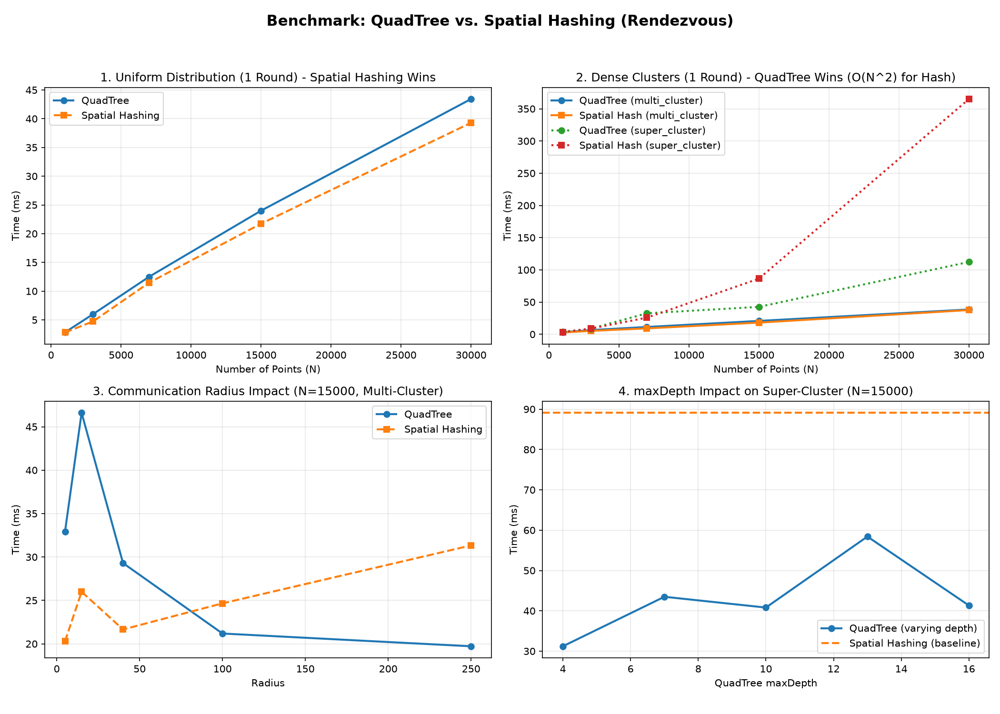
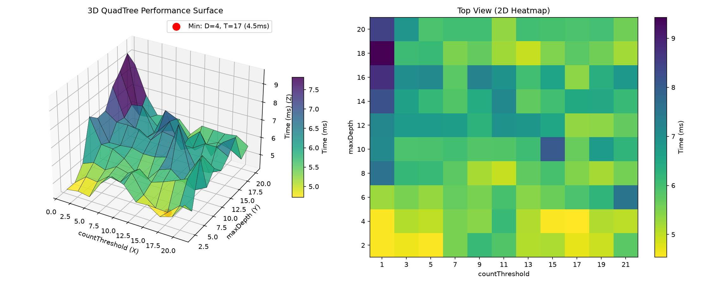

# Distributed Systems Labs (Go)

Concurrent implementations of distributed systems algorithms in **Go** using goroutines, channels, and spatial indexing.

---

## Lab 5: Multi-Agent Rendezvous (`src/lab5`)

Simulates `N` autonomous robots in 2D space converging to a single point via synchronous **Look-Compute-Move (LCM)** averaging within a communication radius `R`:

```text
p_i(t + 1) = (1 / |Neighbors_i(t)|) * sum(p_j(t))   for all j within radius R
```

Instead of the baseline `O(N²)` approach (designed for `N <= 50`), this implementation scales to **`N = 30,000+` agents** using concurrent spatial structures and `ε`-deduplication (`compressPoints` with `ε = 1e-5`):

| Structure | File | Mechanism | Complexity |
| :--- | :--- | :--- | :--- |
| **QuadTree** | `QuadTree.go` | Adaptive 2D tree (`maxDepth`, `countThreshold`) that pre-aggregates `count`, `sumX`, and `sumY` per node. Subtrees fully inside the query radius return in **`O(1)`** without visiting leaves. | `O(N log N)` |
| **Spatial Hashing** | `SpatialHashing.go` | Uniform grid of cell size `R × R` querying only the `3 × 3` neighboring cells. | `O(N)` uniform / `O(N²)` dense |

### Benchmark Results (`src/lab5/Benchmark`)



* **Uniform Distribution:** `Spatial Hashing` is ~15% faster due to `O(1)` bucket lookups and zero tree traversal overhead.
* **Dense Clusters (`super_cluster`):** `Spatial Hashing` degrades to **`O(N²)`** (~365 ms at `N = 30,000`) as all points fall into adjacent cells, while `QuadTree` stays near-linear (~112 ms, **3.25x speedup**) via `O(1)` subtree aggregation.
* **Communication Radius:** Larger radii slow down `Spatial Hashing` (more points per cell) but speed up `QuadTree` (entire clusters are aggregated at shallow tree levels).



* **Hyperparameter Tuning (`N = 8,000`, `R = 35`):** Global minimum achieved at **`maxDepth = 7`, `countThreshold = 32` (`36.9 ms`)**, balancing tree depth against L1 cache locality at the leaves.

---

## Lab 4: Leader Election & Majority Voting (`src/lab4`)

Nodes are modeled as independent goroutines communicating strictly via Go channels:

1. **Unidirectional Ring Flooding (`exercise1.go`):**
   Asynchronous leader election (`RingFlooding`). Nodes forward only IDs larger than their own; the node receiving its own ID becomes leader and propagates a `Done` token around the ring.
2. **Strongly Connected Graph Flooding (`exercise2.go`):**
   Synchronous round-based max-ID propagation (`GraphFlooding`). Uses a local `pendingMsgs` buffer to handle out-of-order future-round messages between asynchronous goroutines.
3. **Majority Voting via Average Consensus (`exercise3.go`):**
   Leaderless binary voting (`AverageFlooding`). In each round, every node updates its state to the average of its own value and its incoming neighbors' values:
   ```text
   x_i(t + 1) = (x_i(t) + sum(x_j(t))) / (inDegree_i + 1)
   ```
   After convergence, the global majority is decided locally via `x_i > 0.5`.

---

## Quick Start

```bash
# Run Lab 4
cd src/lab4
go run .

# Run Lab 5
cd src/lab5/lab_main
go run .

# Run Lab 5 Benchmarks
cd src/lab5/Benchmark
python benchmark_quadTree_spatialHashing.py
python benchmark_3d.py
```
